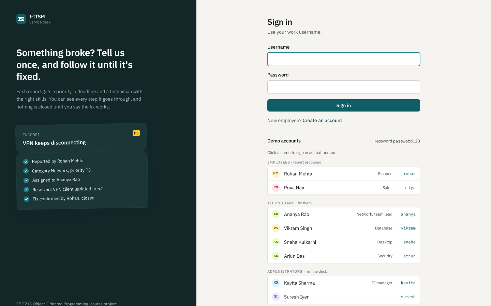
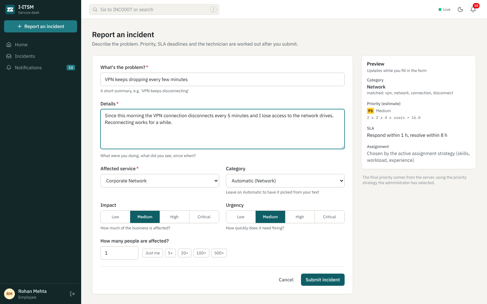
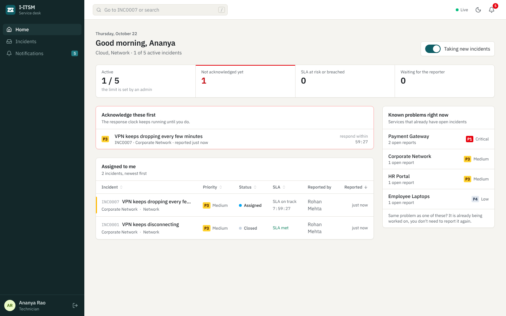

# I-ITSM: IT Service Management and Incident Resolution

Course project for CS F213 Object-Oriented Programming, Semester I 2026-27.

Employees report IT problems through a web page. Each incident is classified, given a priority (P1 to P4)
and SLA deadlines, assigned to a technician, and tracked through its lifecycle until it is closed:

New, Classified, Assigned, Acknowledged, In progress, Resolved, Verified, Closed.

Illegal moves (for example closing an incident that was never resolved) are rejected by the State pattern
in `model/state`.


## Features

- Three roles with their own screens: employee, technician, administrator. Login with JWT tokens, passwords stored with BCrypt.
- Priority from impact, urgency, business criticality of the service and number of affected users. Two priority strategies (weighted score, ITIL matrix) that the admin can switch at runtime.
- Four assignment strategies: smart (skills, experience, past work on the service, workload), skill based, least busy (load based), round robin.
- SLA response and resolution deadlines per priority, a warning before the deadline, breach detection, and escalation of unacknowledged P1/P2 incidents (team lead, then system administrator, then IT manager).
- Notifications in the app and by e-mail (e-mail is simulated: it is written to the log and shown on the Notifications page).
- Full audit log of every change, search with 10 filters, management reports and CSV export.
- Duplicate detection, correlation of related incidents (possible major incident), automatic categorisation, SLA risk score, suggested resolutions from past incidents.
- Live updates: open pages refresh on their own when something changes (Server-Sent Events).

## Technology

| Part | Used |
|---|---|
| Backend | Java 21, Spring Boot 4 (Web, Data JPA, Security, Validation), JWT |
| Database | H2 (file in `data/`, default) or PostgreSQL (`postgres` profile) |
| Frontend | React 19 with TypeScript, Vite, TanStack Query, React Router, Tailwind CSS, Recharts |
| Tests | JUnit 5, Spring MockMvc, AssertJ; Vitest and Testing Library for the frontend |

## Running it

Only a JDK (21 or newer) is needed. The Maven wrapper downloads Maven, and the `ui` profile downloads
its own copy of Node.js into `frontend/node/`.

```bash
# Windows
mvnw.cmd -Pui spring-boot:run
# macOS / Linux
./mvnw -Pui spring-boot:run
```

When the log shows `Started ItsmApplication`, open http://localhost:8080. The first run takes a few minutes.

- The first start creates the database in `data/` and loads demo data. Delete `data/` to start over
  (do this before recording a demo, otherwise old incidents show as SLA breached).
- API documentation: http://localhost:8080/swagger-ui.html
- Backend only: run `src/main/java/com/itsm/ItsmApplication.java` from the IDE.
- Frontend development server: `cd frontend`, `npm install`, `npm run dev` (port 5173, needs Node.js 20+).
- One runnable file: `mvnw.cmd -Pui package`, then `java -jar target/i-itsm-0.1.0.jar`.
- PostgreSQL: create a database `itsm`, then `mvnw.cmd spring-boot:run -Dspring-boot.run.profiles=postgres`
  (settings in `application-postgres.properties`, or `ITSM_DB_URL`, `ITSM_DB_USER`, `ITSM_DB_PASSWORD`).

## Demo accounts

All demo accounts use the password `password123`.

| Username | Name | Role |
|---|---|---|
| `rohan` | Rohan Mehta | Employee, Finance |
| `priya` | Priya Nair | Employee, Sales |
| `ananya` | Ananya Rao | Technician: network, cloud. Team lead, 8 years |
| `vikram` | Vikram Singh | Technician: database, application, storage. 5 years |
| `sneha` | Sneha Kulkarni | Technician: hardware, software, e-mail. 3 years |
| `arjun` | Arjun Das | Technician: authentication, security, application. 6 years |
| `kavita` | Kavita Sharma | Administrator, IT manager (last escalation level) |
| `suresh` | Suresh Iyer | Administrator, system administrator |

## Tests

```bash
mvnw.cmd test             # 37 backend tests
cd frontend && npm test   # 20 frontend tests
```

The test cases are listed in [docs/TEST_CASES.md](docs/TEST_CASES.md), along with three workflows that were
also checked by hand in a browser.

## Code layout

```
src/main/java/com/itsm
  model/          User hierarchy, Incident, enums, SLA policy
  model/state/    State pattern, one class per incident status
  strategy/       Strategy pattern for priority and technician assignment
  event/          Observer pattern: incident events with audit and notification listeners
  live/           Third listener, pushes changes to open browsers
  notification/   Notification channels (in-app, e-mail) and their factory
  intelligence/   Duplicate detection, correlation, categorisation, SLA risk, suggestions
  service/        Incident workflow, SLA monitor, search, reports, users, catalogue
  repository/     Spring Data JPA repositories
  security/       JWT handling and the current user
  config/         Security, clock, Swagger, demo data, serving the React app
  exception/      Custom exceptions
  web/            REST controllers and DTOs

frontend/src
  api/            Types and one function per REST endpoint
  auth/           Login state
  layout/         Side menu, top bar, notification bell
  components/     Badges, incident table, SLA timers, charts, dialogs
  pages/          One file per screen
  test/           Frontend unit tests
```

## Screenshots

| | |
|---|---|
|  Login |  Reporting an incident |
|  Technician queue |  Technician asks the reporter a question |
|  Ranked technicians for manual assignment |  Reports |
