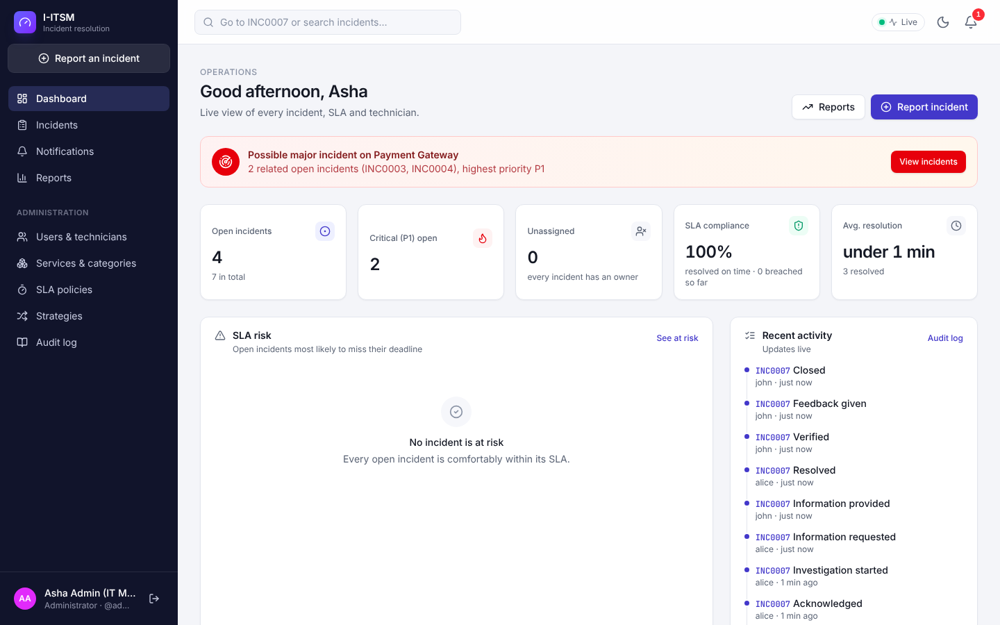
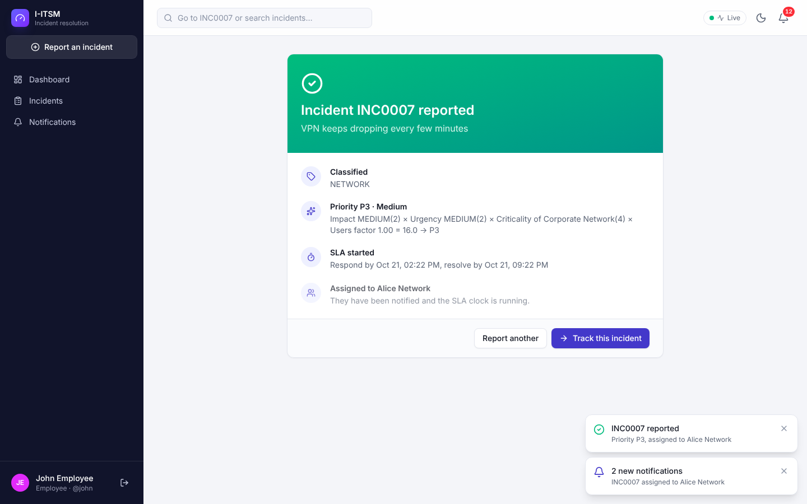
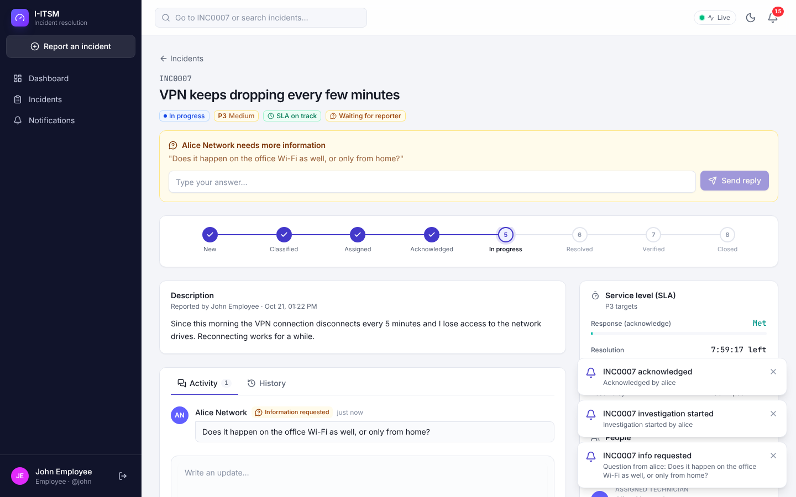
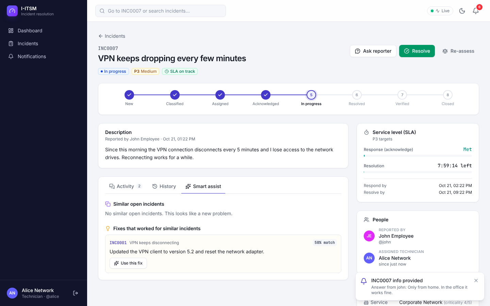
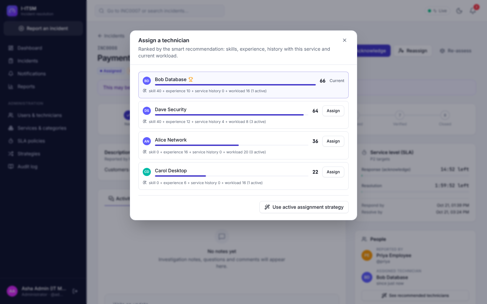
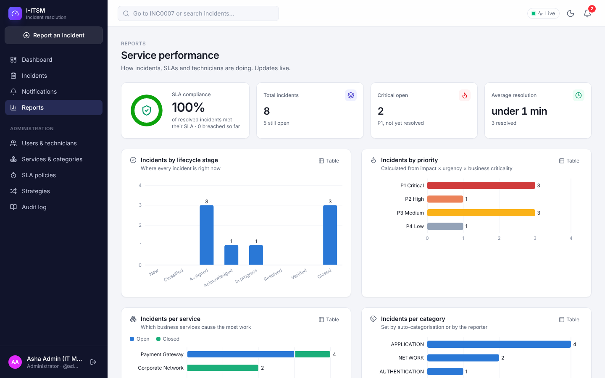
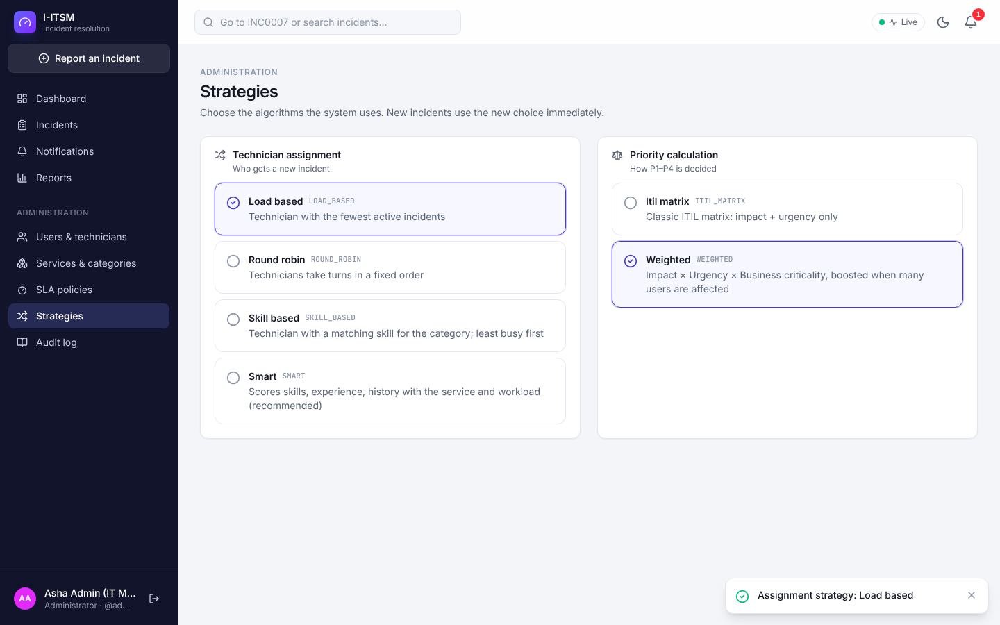
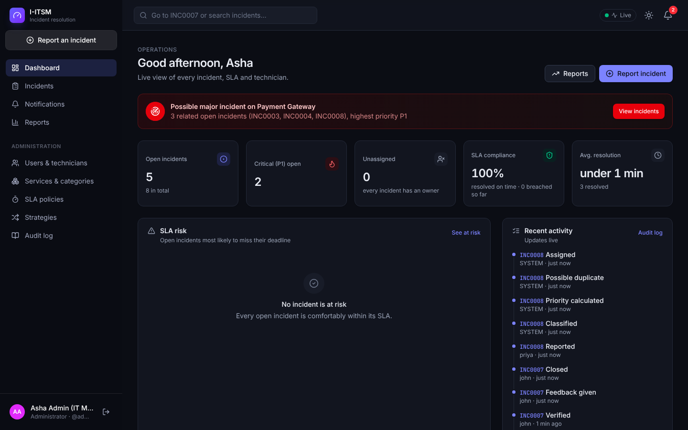

# I-ITSM: Intelligent IT Service Management & Incident Resolution System

CS F213 Object-Oriented Programming course project (Semester I, 2026-27).

An employee reports an IT problem. The system classifies it, calculates its priority, applies the SLA,
picks the best technician, notifies everyone, tracks the deadlines, escalates when nobody responds and
keeps a full audit trail until the incident is closed.

**Report → Classify → Prioritize → Assign → Investigate → Resolve → Verify → Close**

* **Backend:** Java 21, Spring Boot 4, JPA, H2/PostgreSQL, JWT security, live updates (Server-Sent Events).
  Walkthrough: [docs/GUIDE.md](docs/GUIDE.md).
* **Frontend:** React 19 + TypeScript (Vite, React Query, Tailwind, Recharts), one dashboard per role,
  light and dark mode, works on phones. Walkthrough: [docs/FRONTEND_GUIDE.md](docs/FRONTEND_GUIDE.md).



---

## Run it

You only need a JDK (Java 21 or newer). Maven and Node.js do not need to be installed:
`mvnw` downloads Maven, and the `ui` profile downloads its own Node.js into `frontend/node/`.

**The whole app (website + API) with one command**
```bash
# Windows
mvnw.cmd -Pui spring-boot:run
# macOS / Linux
./mvnw -Pui spring-boot:run
```
Wait for `Started ItsmApplication`, then open **http://localhost:8080** and click one of the demo accounts.
The first run takes a few minutes (it downloads Node.js and the JavaScript libraries); later runs are quicker.

**Only the backend (from VS Code)**
1. Open the `i-itsm` folder.
2. Open `src/main/java/com/itsm/ItsmApplication.java`.
3. Click **Run** above the `main` method.
4. Wait for `Started ItsmApplication`, then open **http://localhost:8080/swagger-ui.html**.

**Frontend developer mode** (needs Node.js 20+): start the backend, then
```bash
cd frontend
npm install
npm run dev          # http://localhost:5173, refreshes instantly when you save a file
```

The first start creates a small database in the `data/` folder and fills it with demo data.
Delete the `data/` folder to start again from scratch.

**A single file to hand in or deploy:** `mvnw.cmd -Pui package` creates `target/i-itsm-0.1.0.jar`;
run it anywhere with `java -jar target/i-itsm-0.1.0.jar`.

## Demo accounts

Every account uses the password **`password123`**.

| Username | Role | Notes |
|---|---|---|
| `admin` | Administrator | IT Manager (top of the escalation chain) |
| `sysadmin` | Administrator | System administrator |
| `alice` | Technician | NETWORK, CLOUD · team lead · 8 years |
| `bob` | Technician | DATABASE, APPLICATION, STORAGE · 5 years |
| `carol` | Technician | HARDWARE, SOFTWARE, EMAIL · 3 years |
| `dave` | Technician | AUTHENTICATION, SECURITY, APPLICATION · 6 years |
| `john` | Employee | Finance |
| `priya` | Employee | Sales |

## Try the API in Swagger

1. Open `POST /api/auth/login` → **Try it out** → body `{"username":"john","password":"password123"}` → **Execute**.
2. Copy the `token` value from the response.
3. Click **Authorize** (top right), paste the token, click **Authorize**.
4. Now try `GET /api/incidents`, `POST /api/incidents`, and the rest.

Log in as `admin` to see reports (`/api/reports/...`) and administration (`/api/admin/...`).

## Run the tests

```bash
mvnw.cmd test        # Windows: 33 backend tests
./mvnw test          # macOS / Linux
cd frontend && npm test   # 19 frontend tests (needs Node.js)
```

Each test is described in [docs/TEST_CASES.md](docs/TEST_CASES.md), together with the three demo workflows
that were run end to end in a real browser.

## Use PostgreSQL instead of H2

H2 needs no installation and is the default. To use PostgreSQL, create a database called `itsm` and start with:
```bash
mvnw.cmd spring-boot:run -Dspring-boot.run.profiles=postgres
```
Connection settings are in `src/main/resources/application-postgres.properties`
(or set `ITSM_DB_URL`, `ITSM_DB_USER`, `ITSM_DB_PASSWORD`).

## Screens

| | |
|---|---|
|  Login with demo accounts |  Report form with live category, priority and SLA preview |
|  What the system did automatically |  Technician queue (updated live) |
|  Technician asks, employee answers |  Smart assist: fixes from similar incidents |
|  Ranked technician recommendation |  Management reports |
|  Switch strategies at runtime |  Dark mode |

## Project layout

```
src/main/java/com/itsm
├── model/          Domain classes: User hierarchy, Incident, enums, SLA policy...
│   └── state/      State pattern: one class per incident status
├── strategy/       Strategy pattern: priority and technician assignment
├── event/          Observer pattern: incident events, audit + notification listeners
├── live/           Third observer: pushes changes to open browsers (Server-Sent Events)
├── notification/   Notification channels (in-app, email) + factory
├── intelligence/   Duplicate detection, correlation, categorisation, SLA risk, suggestions
├── service/        Business logic (incident workflow, SLA monitor, search, reports...)
├── repository/     Repository pattern: database access (Spring Data JPA)
├── security/       JWT token creation, current user lookup
├── config/         Security, clock, Swagger, demo data, serving the React app
├── exception/      Custom exception hierarchy
└── web/            REST controllers and DTOs (the API the frontend calls)

frontend/src
├── api/            TypeScript copies of the DTOs + one function per REST endpoint
├── auth/           Login state
├── live/           Listens for live updates
├── layout/         Sidebar, top bar, notification bell, dark mode
├── components/     Reusable pieces: badges, tables, SLA countdowns, charts, dialogs...
├── pages/          One file per screen (dashboards, report form, incident page, admin pages)
└── test/           Frontend unit tests
```
